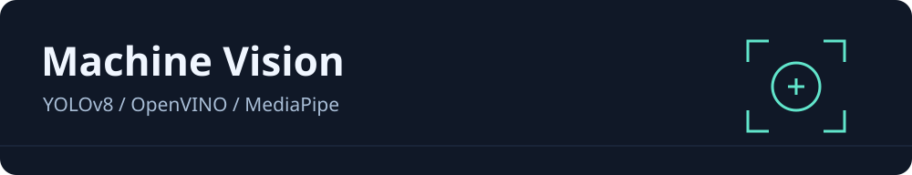

# Machine Vision

Real-time computer vision on a webcam: YOLOv8 detection + tracking, pose and action recognition, gaze, gestures, depth and 3D export — all accelerated with OpenVINO on Intel Arc.

## Quick start

**Windows**

```bat
scripts\setup.bat          :: 1. creates .venv, installs deps, downloads models
scripts\start_vision.bat   :: 2. starts the default profile
```

**Linux / macOS**

```bash
bash scripts/setup.sh                 # 1. venv + deps + models
source .venv/bin/activate
python src/realtime_vision.py --track --speed --eyes   # 2. run
```

1. **`scripts\setup.bat`** — one-time setup: `.venv`, `pip install -r requirements.txt`, `scripts/download_models.py`.
2. **`scripts\start_vision.bat`** — starts with the default profile `--track --speed --eyes`; any extra flags are appended (`start_vision.bat --bg-blur`).

> If the launcher says *«Виртуальное окружение .venv не найдено»* — you skipped step 1.


## Features

Every feature is opt-in. With no flags you get the light profile (detection + pose + actions + distance) at **~18 FPS**.

| Flag | What it does | FPS cost |
|---|---|---|
| *(none)* | YOLOv8m detection, pose, skeleton, actions, distance | 18.0 baseline |
| `--track` | Stable track IDs (`person #1 0.92`) | ~0 |
| `--speed` | Speedometer in m/s and km/h per track | ~0 |
| `--export-csv` | `logs/detections.csv` telemetry | ~0 |
| `--shapes` | OpenCV geometry: Triangle / Square / Circle | −1 |
| `--eyes` | MediaPipe gaze + "looking at camera" | −2 |
| `--emotions` | HAPPY / ANGRY / SURPRISED / NEUTRAL (blendshapes) | ~0 with `--eyes` |
| `--heatmap` | Gaze heatmap, live overlay + `gaze_heatmap.png` | ~0 |
| `--trails` | Fading motion trail per track | ~0 |
| `--gestures` | Fist → play/pause, pointing swipe → prev/next | ~0 |
| `--draw` | Air drawing with the fingertip / nose | ~0 |
| `--ocr` | EasyOCR text reading (background thread) | ~0, but 0.9 s/pass |
| `--bg-blur` | Blur everything that is not a person | −3…−4 |
| `--bg-remove` | Chroma-green background | −3…−4 |
| `--depth` | MiDaS depth blended into the frame | −10…−12 |
| `--depth-map` | MiDaS in a separate MAGMA window | −10…−12 |
| `--async-grab` | Background-thread capture | **+12–15 %** |
| `--all` | Eyes + gestures + drawing + distance at once | 14–15 |

## Architecture

```
VideoStream (optional async grab thread)
        │
        ▼
  detector.track()  ──► IDs ──► speed / trails / CSV
        │
        ├──► pose ──► skeleton, actions, distance
        │
        ├──► features (gaze, gestures, depth, shapes, bg-seg)   ← each behind a flag
        │
        ▼
   overlay (boxes, labels, panels) ──► cv2.imshow
```

```
src/
├── realtime_vision.py      entry point: CLI, main loop, overlays
├── video_stream.py         VideoStream – background frame grabber
├── config.py               shim: import config; config.load()
├── save_3d_scene.py        one frame → MiDaS → coloured .ply
├── features/
│   ├── gaze.py             EyeTracker (gaze) + emotions from blendshapes
│   ├── gestures.py         HandTracker + GestureController
│   ├── air_drawing.py      AirDrawer
│   ├── trails.py           TrailTracker
│   ├── speed.py            SpeedEstimator
│   ├── background.py       Segmenter (--bg-blur / --bg-remove)
│   ├── depth.py            DepthEstimator (MiDaS)
│   ├── heatmap.py          GazeHeatmap
│   ├── ocr.py              OcrEngine (EasyOCR)
│   └── active_learning.py  LowConfidenceSaver
└── utils/
    ├── constants.py        colours, thresholds, tuning defaults
    ├── config.py           YAML loader (flags > config.yaml > defaults)
    ├── calibration.py      pinhole distance + --calibrate
    ├── drawing.py          labels, panels, skeleton
    ├── geometry.py         actions + OpenCV shape detection
    ├── models.py           model resolution / loading
    ├── csv_logger.py       telemetry writer
    ├── log.py              logging setup
    └── mp_utils.py         MediaPipe import shim
```

## Installation

### Windows

```bat
git clone https://github.com/mishaturchin2002-netizen/machine-vision.git
cd machine-vision
scripts\setup.bat
```

### Linux / macOS

```bash
git clone https://github.com/mishaturchin2002-netizen/machine-vision.git
cd machine-vision
chmod +x scripts/setup.sh
./scripts/setup.sh
```

Both scripts create `.venv`, install `requirements.txt` and run `scripts/download_models.py`, which downloads the YOLOv8/MiDaS/MediaPipe weights and exports YOLO to OpenVINO into `models/`.

Manual route:

```bash
python -m venv .venv && source .venv/bin/activate   # Windows: .venv\Scripts\activate
pip install -r requirements.txt
python scripts/download_models.py
```

## Usage

```bash
python src/realtime_vision.py                    # light profile (~18 FPS)
python src/realtime_vision.py --async-grab --track --speed
python src/realtime_vision.py --bg-blur --track
python src/realtime_vision.py --eyes --heatmap
python src/realtime_vision.py --depth-map
python src/realtime_vision.py --all              # everything except depth
```

Windows: `scripts\start_vision.bat [flags]`.

Calibrate the distance numbers once, sitting where you normally sit:

```bash
python src/realtime_vision.py --calibrate 0.6    # writes focal_config.txt
```

Diagnostics:

```bash
python src/realtime_vision.py --benchmark        # torch vs OpenVINO
python src/realtime_vision.py --headless 60      # 60 frames, no window
```

## Performance

Measured on Intel Core Ultra 7 155H (Arc iGPU), 640×480 webcam, YOLOv8m exported to OpenVINO at 640.

| Configuration | Frame time | FPS |
|---|---|---|
| torch CPU, det+pose | 178 ms | 5.6 |
| OpenVINO CPU | 188 ms | 5.3 |
| **OpenVINO Arc GPU** | **24 ms** | **40.9** |
| Full pipeline, base profile | 56 ms | 18.0 |
| Full pipeline, `--all` | 66–71 ms | 14–15 |
| Capture sync vs async | 73–75 vs 65–66 ms | 13.2–13.6 → 15.1–15.5 |

Details and methodology: [docs/BENCHMARKS.md](docs/BENCHMARKS.md).

## Known limitations

- **First segmentation pass takes ~6.5 s** — OpenVINO compiles GPU kernels on first use. It runs in a worker thread, so the UI stays responsive, but the background is not blurred for the first few seconds.
- **`--speed` needs `--track`** — without IDs there is nothing to differentiate between frames, so no speed is shown.
- **Segmentation masks arrive at 640×640** (model input), not at frame size; they are resized per mask before compositing.
- **Distance is an estimate** — pinhole formula with an assumed 1.90 m height. After `--calibrate` it is fitted to *your* framing; change camera/resolution and you must re-calibrate.
- **Emotions are heuristic** — three blendshape pairs, not a classifier. Neutral faces read as NEUTRAL because the pairs must both fire.
- **OCR is not real-time** — ~0.9 s per pass on CPU, hence every 20th frame in a background thread.
- **`intel:auto` silently picks the CPU plugin** — the OpenVINO device must be requested explicitly (`intel:gpu`).

## Hardware

| | Minimum | Recommended |
|---|---|---|
| CPU | any x86-64 / ARM64 | Intel Core Ultra / 11th gen+ |
| GPU | — (OpenVINO CPU) | Intel Arc / Iris Xe (iGPU is enough) |
| RAM | 8 GB | 16 GB+ |
| Camera | any UVC webcam | 720p30+ |
| OS | Windows 10/11, Linux | Windows 11 |

Without an Intel GPU everything still runs on `intel:cpu` (≈5 FPS for the heavy profile) or the torch backend.

## License

MIT — see [LICENSE](LICENSE).

## Acknowledgements

- [Ultralytics YOLOv8](https://github.com/ultralytics/ultralytics) — detection, pose, segmentation, tracking
- [OpenVINO](https://github.com/openvinotoolkit/openvino) — Intel inference acceleration
- [MiDaS](https://github.com/isl-org/MiDaS) — monocular depth
- [MediaPipe](https://github.com/google-ai-edge/mediapipe) — face and hand landmarks
- [EasyOCR](https://github.com/JaidedAI/EasyOCR) — text recognition
- [Open3D](https://www.open3d.org/) — point-cloud export
